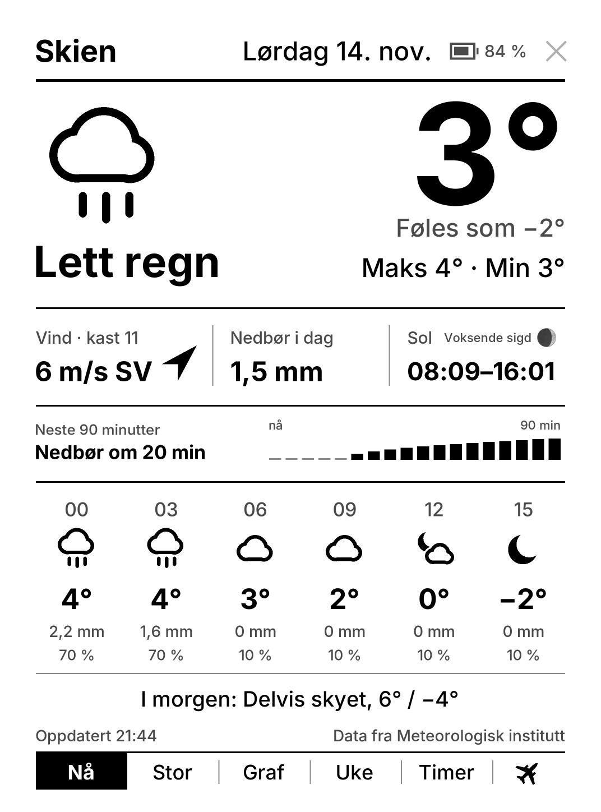
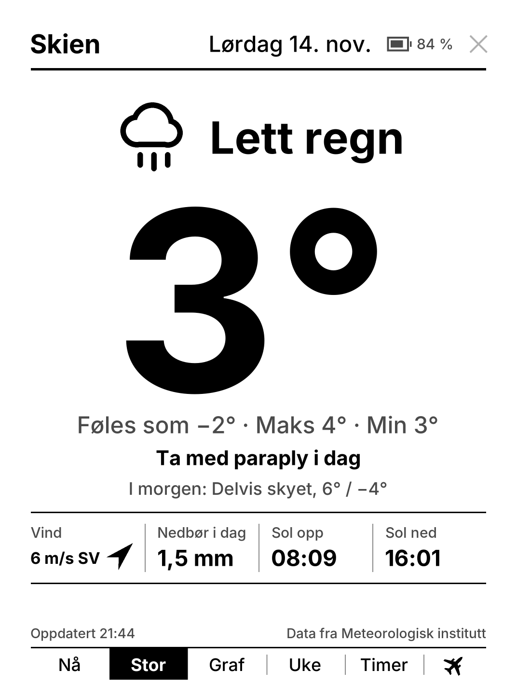
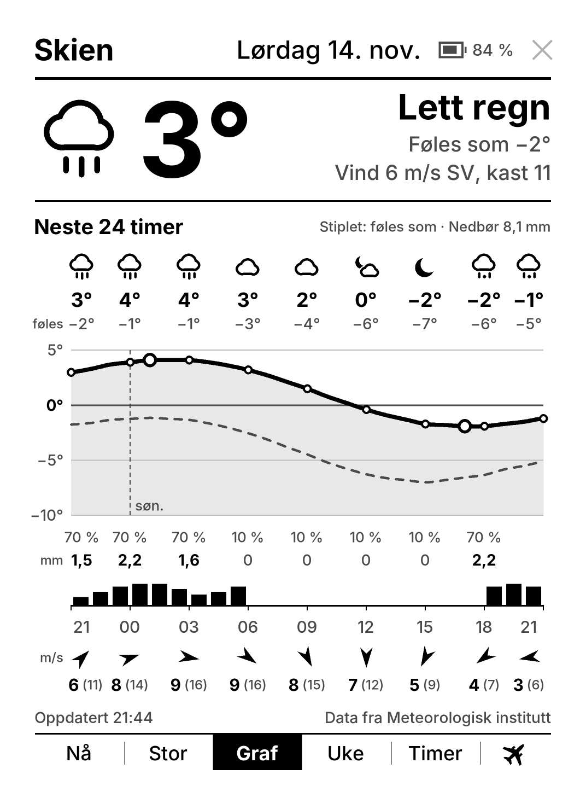
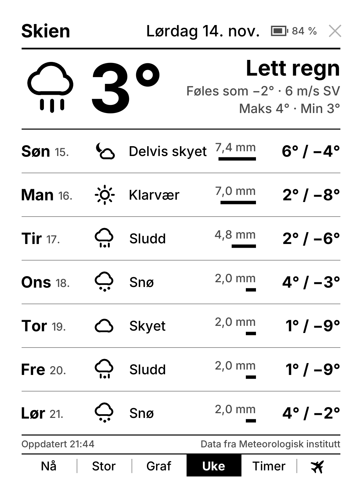
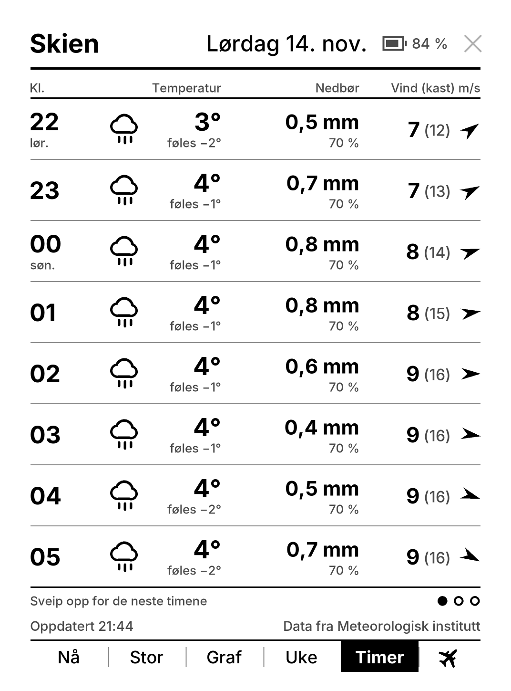
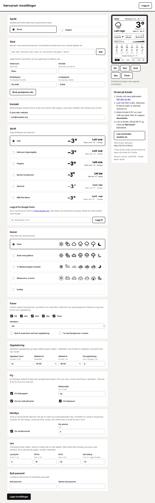
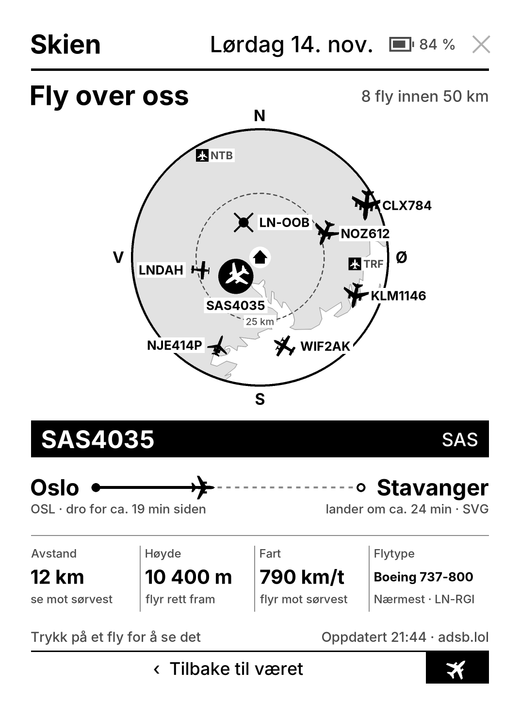

# kindle-weather-norway

**Værvarsel på Kindle.**

Gjør en gammel, jailbreaket Kindle om til en værskjerm som alltid står på. En liten PHP-server tegner varselet fra [Meteorologisk institutt](https://api.met.no/) som et bilde, og et skript på Kindle henter bildet hvert tiende minutt og viser det i fullskjerm.

Skjermene og innstillingssiden er på norsk. Koden og kommentarene er på engelsk.

<table>
  <tr>
    <td></td>
    <td></td>
    <td></td>
    <td></td>
    <td></td>
  </tr>
  <tr>
    <td align="center"><b>Nå</b><br>alt på én skjerm</td>
    <td align="center"><b>Stor</b><br>leses fra andre siden av rommet</td>
    <td align="center"><b>Graf</b><br>de neste 24 timene</td>
    <td align="center"><b>Uke</b><br>sju dager fram</td>
    <td align="center"><b>Timer</b><br>time for time, tre sider</td>
  </tr>
</table>

## Dette får du

- Fem luftige skjermer du bytter mellom med fanene nederst.
- Været nå med vindretning og vindkast, soloppgang og solnedgang, et bilde av månen i riktig fase, og UV-indeks.
- En radarstripe som viser om det kommer nedbør de neste 90 minuttene.
- Farevarsler fra Meteorologisk institutt, som banner og varseltrekant.
- Et meteogram for 24 timer med temperatur, «føles som», nedbør og vind.
- Varsel når det kan bli nordlys: et banner på Nå når NOAA venter nok geomagnetisk aktivitet (Kp) i de mørke timene det neste døgnet, med en merknad hvis varselet sier skyet.
- «Fly over oss»: en flyknapp åpner et kart med flyene i nærheten. Trykk på et fly for å se flyselskapet, ruten, omtrent hvor lenge det har fløyet og har igjen, høyde, fart og flytype. Ulike fly har ulike tegninger: to motorer, fire motorer, propellfly, småfly, jagerfly og helikopter.
- Stilletid med nattskjerm, oppdateringer uten blink, og frontlyset av for å spare batteri.
- En passordbeskyttet innstillingsside for sted, skrift, ikoner, faner, oppdateringstider og frontlys. Kindle henter endringene selv.
- Seks innebygde skrifter, alle skrifter fra Google Fonts ved behov, og fem ikonsett.
- Beskjed når batteriet er lavt eller varselet er gammelt. Mister Kindle forbindelsen, viser den det sist kjente varselet og timene framover, og prøver igjen av seg selv.
- Norsk eller engelsk på skjermene og innstillingssiden. Du velger selv.





Flere skjermer: [fly valgt med trykk](docs/screenshots/flights-tapped.png), [tom himmel](docs/screenshots/flights-empty.png), [farevarsel](docs/screenshots/alert.png), [nordlys](docs/screenshots/aurora.png), [lavt batteri](docs/screenshots/low-battery.png), [natt](docs/screenshots/night.png), [ingen forbindelse](docs/screenshots/offline.png), [lukker](docs/screenshots/closing.png). De samme skjermene på engelsk ligger i [docs/screenshots/en](docs/screenshots/en).

## Dette trenger du

- **En Kindle som er jailbreaket.** Laget og testet på Kindle Paperwhite 4 (10. generasjon), programvare 5.18.1. Andre modeller med samme skjerm (1072 × 1448) skal fungere. Andre skjermstørrelser krever at oppsettet tilpasses.
- **Et webhotell med PHP 8.1 eller nyere** og utvidelsene `gd` (med FreeType), `zlib` og `openssl`. De fleste vanlige webhoteller har det. Kindle må kunne nå serveren, og serveren må kunne hente data over HTTPS. Du kan også bruke en PC eller Raspberry Pi hjemme, se under.
- **Et sted Meteorologisk institutt dekker.** Varselet gjelder hele verden. Radarstripen dekker Norden, og farevarslene dekker Norge.

Kindle må stå i laderen. Skjermen holder den våken med Wi-Fi på.

## Slik setter du det opp

Du trenger ikke redigere noen filer. Alt gjøres i nettleseren, bortsett fra å kopiere én fil til Kindle.

### 1. Jailbreak Kindle

Følg veiviseren på [Kindle Modding Wiki](https://kindlemodding.org/) (på engelsk). Den forteller hvilken metode som passer for modellen og programvareversjonen din. Prosjektet trenger støtte for «scriptlets», som dagens jailbreak-metoder har, og automatiske oppdateringer må være blokkert slik at jailbreaken overlever.

### 2. Legg serveren på nett

1. Last ned prosjektet (den grønne «Code»-knappen på GitHub, så «Download ZIP») og pakk det ut.
2. Last opp innholdet i mappen `server` til en mappe på webhotellet ditt.
3. Åpne `admin.php` i nettleseren **med en gang**, for eksempel `https://dittnavn.no/vaer/admin.php`, og velg et passord. Den første som åpner siden bestemmer passordet, så ikke la en ny installasjon stå uten.
4. Under «Sted»: søk etter adressen din eller et stedsnavn og velg riktig treff. Søket bruker Kartverkets åpne registre og kjenner alle norske adresser. Utenfor Norge skriver du inn koordinatene selv eller trykker «Bruk posisjonen min».
5. Under «Kontakt»: skriv inn e-postadressen eller nettstedet ditt. Meteorologisk institutt krever at alle som henter data oppgir det, og kan blokkere dem som ikke gjør det. Den sendes bare til dem.
6. Trykk «Lagre innstillinger». Forhåndsvisningen til høyre skal nå vise varselet ditt.

Mangler webhotellet noe, står det øverst på siden hva som må ordnes.

### 3. Legg det på Kindle

1. Trykk «Last ned kindle-weather.sh» på innstillingssiden. Adressen til serveren din er allerede skrevet inn i filen, og den står under knappen så du kan se at den stemmer.
2. Koble Kindle til PC-en med USB og kopier filen til mappen `documents`.
3. Løs ut Kindle, slå på Wi-Fi og trykk **én gang** på «Værvarsel» i biblioteket.

Biblioteket blir stående mens Kindle henter det første bildet. Det kan ta opptil et halvt minutt. Et trykk til på «Værvarsel» stopper den igjen, så trykk én gang og vent.

Ferdig. Alt annet (faner, tider, skrift, ikoner) endrer du på innstillingssiden, og Kindle henter endringene selv.

**Bruk filen fra nedlastingsknappen, ikke den som ligger i zip-filen.** Kopien i `server/kindle/` har en eksempeladresse (`https://example.com/weather/`) og når ikke serveren din før adressen er byttet. Vil du bruke den likevel, se «For hånd» under.

### Hva ligger hvor

Det er lett å blande, så her er hele bildet.

**På webhotellet:** hele innholdet i mappen `server`, også undermappen `kindle`. Nedlastingsknappen leser `kindle/kindle-weather.sh` derfra og fyller inn adressen, så uten den mappen får du feilmeldingen «Finner ikke filen kindle/kindle-weather.sh på serveren».

**På Kindle** (slik den ser ut over USB):

```
documents/
  kindle-weather.sh       skriptet; det eneste du må kopiere selv
kindle-weather/           lages av skriptet første gang det kjører
  log.txt                 logg over oppdateringer og trykk
  settings.sh             valgfri: dine egne innstillinger (se «For hånd»)
  server-settings.txt     innstillingene Kindle hentet fra serveren sist
  weather.png  og flere   bildene som vises
```

Ingenting annet fra prosjektet skal til Kindle. `tools/`, `docs/` og README hører bare hjemme i prosjektet.

**To vanlige feil:**

- `settings.sh` lagt i `documents`. Der leses den ikke, og den dukker opp i biblioteket som noe du kan starte. Den skal ligge i `kindle-weather`.
- `kindle-weather.sh` kopiert rett fra zip-filen. Da stopper den med «Ingen kontakt med serveren» og viser eksempeladressen.

### Når du oppdaterer til en ny versjon

1. Lukk værskjermen på Kindle med krysset.
2. Last opp hele mappen `server` på nytt. Innstillingene dine ligger i `data/` og blir ikke overskrevet.
3. Last ned `kindle-weather.sh` fra innstillingssiden på nytt og kopier den til `documents`, hvis skriptet er endret. Er du usikker, gjør det uansett.

### Uten webhotell

En datamaskin hjemme som alltid står på kan være server, for eksempel en Raspberry Pi med PHP installert:

```
php -S 0.0.0.0:8000 -t server
```

Åpne så `http://<maskinens adresse>:8000/admin.php` fra en annen enhet på samme nett, og fortsett fra punkt 3 under «Legg serveren på nett».

### For hånd

Det stegene over ordner for deg, hvis du heller vil bruke filer:

- **Server:** kopier `server/config.example.php` til `server/config.php` og fyll den ut. Innstillingssiden vinner over filen.
- **Kindle:** kopier `server/kindle/kindle-weather.sh` til `documents`. Lag så en mappe som heter `kindle-weather` øverst på Kindle, ved siden av `documents`, og legg en fil som heter `settings.sh` der med denne linjen, med din egen adresse:

  ```
  SERVER_URL="https://dittnavn.no/vaer/"
  ```

  `server/kindle/settings.example.sh` er en mal med flere innstillinger. Det som står i `settings.sh` vinner over det som står i skriptet, så dette virker også med en nedlastet fil. Behold Unix-linjeskift (LF): rediger med VS Code eller Notepad++, ikke Notisblokk.
- **Første test på en uprøvd Kindle-modell:** sett `STOP_GUI=0` i `settings.sh`. Da fortsetter Kindles eget grensesnitt å kjøre, slik at du kan stoppe værskjermen ved å trykke på «Værvarsel» igjen, også hvis trykk på skjermen ikke virker på din modell.

## Slik bruker du den

- **Bytt skjerm:** trykk på en fane nederst. Kindle husker valget.
- **Oppdater nå:** trykk på øvre halvdel av skjermen.
- **Bla i timene:** fanen Timer har tre sider med åtte timer på hver. Sveip opp for de neste timene og ned for de forrige. Et trykk på nedre halvdel går til neste side, og fra den siste tilbake til den første. En vanlig oppdatering går tilbake til første side.
- **Se på fly:** trykk på flyet nederst til høyre for å åpne «Fly over oss». Trykk på et fly på kartet for å se mer om det. Skjermen oppdateres hvert minutt og går tilbake til været av seg selv etter et kvarter. «Tilbake til været» nederst lukker den med en gang.
- **Lukk:** trykk på det svake krysset øverst til høyre. Kindle viser en avskjedsskjerm mens dens eget grensesnitt starter igjen, noe som tar omtrent et halvt minutt.

Slutter skjermen å svare, holder du inne av/på-knappen i omtrent 40 sekunder til Kindle starter på nytt. Ingenting endres permanent. Etter en omstart er det en vanlig Kindle igjen.

## Innstillinger

**Innstillingssiden** (`admin.php` på serveren) er det enkleste stedet å endre noe. Den er beskyttet med passord og dekker:

- språk: norsk eller engelsk (se under)
- stedsnavn og koordinater
- kontaktadressen som sendes til Meteorologisk institutt
- skrift og ikonsett (se under)
- hvilke faner som vises, og hvilken som kommer først
- hvor ofte skjermen oppdateres, stilletid, og hvor ofte skjermen blinker helt
- flyskjermen: av eller på, og hvor langt den ser
- nordlysvarselet: av eller på, og Kp-grensen som utløser det
- frontlysets styrke og tider

Kindle spør serveren om innstillingene ved hver vanlige oppdatering, så endringer vises innen ett intervall uten at du rører Kindle.

Innstillingene leses i denne rekkefølgen, der de siste vinner: innebygde standardverdier, `server/config.php`, innstillingssiden. På Kindle: standardverdiene i `kindle-weather.sh`, `settings.sh`, og til slutt det serveren sender. Det du lagrer på innstillingssiden ligger i `server/data/store.php`, som ikke er med i git og ikke kan leses over nettet. Glemmer du passordet, sletter du den filen og setter det opp på nytt.

**Språk**

Velg norsk eller engelsk øverst på innstillingssiden. Valget gjelder både skjermene på Kindle og innstillingssiden, og farevarslene hentes på samme språk fra Meteorologisk institutt. Første gang du åpner innstillingssiden følger den språket i nettleseren. I `config.php` heter innstillingen `language`, med verdien `no` eller `en`.

De få tekstlinjene Kindle skriver selv mens den starter, og navnet i biblioteket («Værvarsel» eller «Weather»), følger språket som var valgt da du lastet ned `kindle-weather.sh`. Last ned filen på nytt hvis du vil bytte dem også, eller sett `LANGUAGE=en` i `settings.sh`.

**Skrifter**

| Nøkkel | Skrift | Preg |
| --- | --- | --- |
| `inter` | Inter | Nøytral grotesk (standard) |
| `atkinson` | Atkinson Hyperlegible | Laget for å være lett å lese på avstand |
| `poppins` | Poppins | Rund og geometrisk |
| `barlow` | Barlow Condensed | Smal, som en avgangstavle |
| `spectral` | Spectral | Med seriffer |
| `plexmono` | IBM Plex Mono | Fast bredde |

Alle skrifter fra [Google Fonts](https://fonts.google.com/) kan legges til på innstillingssiden: skriv navnet under «Legg til fra Google Fonts». Serveren laster ned en vanlig og en fet vekt én gang, lagrer dem i `server/data/fonts/`, sjekker at skriften har æ, ø og å, og velger en størrelsesfaktor ved å sammenligne bredden med Inter. Kindle har aldri kontakt med Google. Den får bare ferdige bilder. Opptil 12 kan være installert, og hver har en «Fjern»-lenke.

Vil du heller bygge inn en skrift, legger du en vanlig og en fet fontfil i `server/fonts/` og en linje i `FONTS` i `server/src/settings.php`. Tallet `scale` jevner ut hvor stor en skrift faller. Senk det hvis tekst kolliderer.

**Ikonsett**

| Nøkkel | Stil | Kilde |
| --- | --- | --- |
| `outline` | Strektegninger, tegnet i kode | dette prosjektet |
| `duotone` | De samme strekene med grå fyll | dette prosjektet |
| `yr` | Yrs offisielle symboler, i gråtoner | [Yr weather icons](https://github.com/metno/weathericons) |
| `meteocons` | Tofargede omriss | [Meteocons](https://github.com/basmilius/weather-icons) |
| `bold` | Kraftige strekikoner | [Weather Icons](https://github.com/erikflowers/weather-icons) |

Bildesettene ligger som PNG-filer i `server/icons/`. `tools/build-icons.py` bygger dem på nytt fra originalfilene.

**Serverfil** (`server/config.php`, valgfri): de samme serverinnstillingene som en fil. Se `config.example.php`.

**Kindle** (`kindle-weather/settings.sh` på Kindle, valgfri): det du setter her erstatter standardverdien øverst i `kindle-weather.sh`, så en ny versjon av skriptet overskriver aldri innstillingene dine. Innstillingene merket med * erstattes av verdiene fra innstillingssiden så snart Kindle har nådd serveren.

| Innstilling | Standard | Betydning |
| --- | --- | --- |
| `SERVER_URL` | | Adressen til serveren. Allerede fylt inn i filen du laster ned fra innstillingssiden |
| `INTERVAL_MIN` * | `10` | Minutter mellom oppdateringene |
| `QUIET_START`, `QUIET_END` * | `0`, `6` | Stilletid (24-timers klokke). Skjermen viser en nattskjerm og slutter å oppdatere. Sett begge til samme tall for å slå det av |
| `FULL_REFRESH_EVERY` * | `6` | Hver n-te oppdatering blinker skjermen for å fjerne skygger. De andre oppdaterer stille |
| `LIGHT_CONTROL` | `1` | La skriptet styre frontlyset. `0` lar det være i fred |
| `LIGHT_LEVEL` * | `0` | `0` holder frontlyset av hele døgnet, som sparer mest batteri. `1`–`24` slår det på med den styrken om kvelden |
| `LIGHT_FROM`, `LIGHT_TO` * | `16`, `24` | Timene lyset er på, når `LIGHT_LEVEL` er over 0 |
| `STOP_GUI` | `1` | Stopp Kindles grensesnitt mens værskjermen kjører. `0` lar det kjøre, for testing |
| `TOUCH_CONTROLS` | `1` | Faner, trykk for å oppdatere, sveip og lukkeknappen |
| `FLIGHTS` * | `1` | Vis flyknappen |
| `FLIGHT_INTERVAL_SEC` | `60` | Sekunder mellom oppdateringene mens flyskjermen er åpen |
| `FLIGHT_TIMEOUT_MIN` | `15` | Gå tilbake til været av seg selv etter så mange minutter |
| `TABS`, `DEFAULT_VIEW` * | `now big graph week hours`, `now` | Hvilke skjermer som vises som faner, og hvilken som vises først |

## Slik virker det

```
Meteorologisk institutt  ──JSON──▶  PHP-server  ──PNG──▶  Kindle
(api.met.no)                        (server/)             (kindle-weather.sh)
```

1. Kindle ber serveren om en skjerm, for eksempel `/?view=graph&batt=84&x=1`.
2. Serveren laster ned varselet fra Meteorologisk institutt, eller bruker den lagrede kopien til MET sier at den er utløpt.
3. Serveren tegner skjermen som en PNG på 1072 × 1448 punkter i 8-biters gråtoner og sender den tilbake.
4. Kindle viser bildet med det innebygde verktøyet `eips`, og venter på neste oppdatering eller et trykk.

Kindle tegner ingenting selv. Alt det visuelle ligger på serveren, så du endrer en skjerm ved å redigere PHP, og Kindle viser den ved neste oppdatering.

## Mappene i prosjektet

```
server/                     bildeserveren (last opp denne mappen)
  index.php                 inngangen: én forespørsel inn, én PNG ut
  admin.php                 innstillingssiden, beskyttet med passord
  flights.php               flyskjermen «Fly over oss», som egen inngang
  config.example.php        mal for den valgfrie config.php (ikke i git)
  fonts/                    skriftene, med lisensene sine
  icons/                    ikonsettene med lisenser, og månebildene
  map/                      for flyskjermen: flyplasser, flyselskaper, og en grov kystlinje som reserve for Kartverkets kart
  src/
    bootstrap.php           laster koden og innstillingene
    i18n.php                språk: oversetter tekstene, datoer og tall
    lang/                   de engelske tekstene (en.php for skjermene, admin.en.php for innstillingssiden)
    settings.php            innstillinger: standardverdier, kontroll, lagring
    fonts.php               skriftlisten og nedlasting fra Google Fonts
    flights.php             flydata: fly i nærheten, ruter, hvilket fly som er valgt
    flightmap.php           kartet under flyene: Kartverket, med kystlinje som reserve
    setup.php               sjekk av webhotellet og Kindle-filen med adressen fylt inn
    app.php                 gangen i en forespørsel: les spørringen, hent data, velg skjerm
    met.php                 henter fra Meteorologisk institutt og NOAA, med mellomlager
    model.php               gjør METs JSON om til «modellen» skjermene leser
    weather.php             hjelpere: symbolnavn, formatering, vindavkjøling, månefase
    Canvas.php              tegneflaten: former, tekst, ikoner, PNG
    layout.php              felles deler: topp, bunn, faner, bannere, rader
    chart.php               meteogrammet
    views.php               listen over faner og skjermer
    views/                  én fil per skjerm
  kindle/                   det som kjører på Kindle (innstillingssiden deler det ut)
    kindle-weather.sh           skriptet; kopieres til mappen documents på Kindle
    settings.example.sh     mal for en valgfri settings.sh på Kindle
    Probe.sh                rapporterer hva Kindle støtter av hvilemodus (endrer ingenting)
tools/
  preview.php               tegner alle skjermene med eksempeldata
  sample-data.php           eksempeldataene den bruker
  build-icons.py            gjør de nedlastede ikonsettene om til PNG
  build-moon.py             tegner månebildene fra et kart over måneoverflaten
  build-coast.py            lager den grove kystlinjen i server/map/
  build-airports.py         lager listen over flyplasser i server/map/
  build-airlines.py         lager listen over flyselskaper i server/map/
docs/screenshots/           bildene i denne filen
```

## Utvikling

### Forhåndsvis uten Kindle

```
php tools/preview.php
```

Dette tegner alle skjermene med oppdiktet vær til `docs/screenshots/`, uten å kontakte Meteorologisk institutt og uten å lese `config.php`. Kjør det etter at du har endret en skjerm for å se resultatet. Oppgi et mappenavn for å skrive bildene et annet sted. `php tools/preview.php docs/screenshots/en outline inter en` tegner dem på engelsk.

For å prøve den ekte serveren lokalt kjører du `php -S localhost:8000 -t server` og åpner `http://localhost:8000/?view=now&x=1`.

### Slik er en skjerm bygget

En skjerm er en funksjon som får modellen og gir tilbake en PNG. Et nedstrippet eksempel:

```php
function render_big(array $m, array $req, array $config): string
{
    $c = new Canvas($config['width'], $config['height'], $config['font_dir']);
    draw_header($c, $m['place'], $m['date'], $req['batt'], $req['touch']);
    $c->text($m['temp'], 536, 622, 520, 'Bold', INK, 'center');
    draw_footer($c, $m['updated'], $req['touch'], 'big', $m['stale']);
    return $c->png();
}
```

- `$m` er modellen: alt som er verdt å vise, ferdig formulert på norsk. Feltene står øverst i `src/model.php`.
- `$req` er forespørselen: batterinivå, om trykkflatene skal tegnes, og så videre.
- `Canvas` plasserer alt i skjermpunkter. Tekst plasseres etter midten av de store bokstavene, så den er lett å stille på linje med ikoner.

Oppsettet er håndplasserte koordinater, ikke en layoutmotor. Hver skjermfil starter med en kort beskrivelse av hva som står hvor.

### Legg til en fane

1. Kopier en fil i `server/src/views/` og skriv funksjonen `render_<navn>()`.
2. Legg den til i `TAB_LABELS` og `SCREENS` i `server/src/views.php`.
3. Slå den på under «Faner» på innstillingssiden. Kindle får fanelisten fra serveren.

Fanelinjen deler bredden likt, så Kindle regner ut hvilken fane som ble trykket ut fra antallet faner alene.

### Vis mer data

1. Finn feltet i svaret fra Meteorologisk institutt. [Datamodellen](https://api.met.no/doc/locationforecast/datamodel) viser hva som finnes.
2. Les det i `flatten_timeseries()` i `src/model.php` og legg det til modellen i `build_model()`.
3. Tegn det i en skjerm.

### Språk og oversettelser

Tekstene i koden er norske. Funksjonen `t()` i `server/src/i18n.php` slår dem opp i `server/src/lang/en.php` når språket er engelsk, og gir teksten uendret tilbake hvis den ikke står der. Legger du til en ny tekst på en skjerm, skriver du `t('Ny tekst')` og legger den engelske varianten i `en.php`. Setninger som settes sammen av flere deler, oversettes del for del, og delene beholder mellomrommene sine. Datoer lages med `date_text()`, og desimaltegnet kommer fra `decimal_mark()`.

Innstillingssiden er skrevet på norsk i `admin.php`. For engelsk byttes de faste tekstene ut på vei til nettleseren, etter listen i `lang/admin.en.php`. Et nytt språk trenger en ny fil ved siden av `en.php`, en linje i `LANGUAGES` og et par tilpasninger i `i18n.php`.

### Trykkflatene

Kindle avgjør hva et trykk betyr ut fra faste områder på skjermen: hjørnet med lukkeknappen, fanelinjen og øvre halvdel. En finger som flytter seg mer enn `SWIPE_MIN` punkter opp eller ned regnes som et sveip. Tallene står øverst i `server/kindle/kindle-weather.sh` og må stemme med det serveren tegner (`TAB_TOP` i `src/layout.php` og lukkeknappen i `draw_header()`). Flytter du det ene, må du endre begge.

### Flyskjermen

`server/flights.php` er en egen inngang som tegner «Fly over oss». Den henter flyene innen rekkevidde fra et åpent ADS-B-nettverk (adsb.lol, med adsb.fi som reserve), slår opp ruten til det valgte flyet, og legger alt oppå et kart.

- **Kartet:** en silhuett av land og vann, uten veier og navn. I Norge lages den én gang per sted av Kartverkets topografiske kart: alt kartet farger blått (sjø, innsjøer, brede elver) blir hvitt, resten lysegrått, og bildet lagres i `cache`. Grensen for hva som regnes som blått er `WATER_BLUENESS` i `src/flightmap.php`. Utenfor Norge, eller når Kartverket ikke svarer, tegnes en grov kystlinje fra Natural Earth (`server/map/coast.json`).
- **Flyselskapet:** navnet kommer fra rutedatabasen når den oppgir det, ellers fra de tre første bokstavene i kallesignalet, slått opp i en kort liste i `src/flights.php` og deretter i `server/map/airlines.json`.
- **Tidene:** «dro for ca. … siden» og «lander om ca. …» er anslag. Ingen åpne kilder oppgir virkelige avgangs- og ankomsttider, så de regnes ut fra avstanden flyet har lagt bak seg og har igjen, med vanlig marsjfart for flytypen (`flight_times()`).
- **Ruten:** to åpne rutedatabaser spørres, først adsb.lol, så adsbdb.com. Flyselskapene bruker kallesignaler om igjen, så svarene kan være utdaterte. Derfor vises en rute bare når den kan stemme med hvor flyet er og hvilken vei det flyr (`route_is_plausible()`). Ellers står det «Ruten er ikke kjent».
- **Flyplasser:** store og mellomstore flyplasser innen rekkevidde merkes på kartet med en liten svart firkant og koden sin, for eksempel TRF for Torp. Listen ligger i `server/map/airports.json`.
- **Trykk:** Kindle sender posisjonen til trykket (`?tap=x,y`). Serveren husker hvor hvert fly ble tegnet sist og velger det nærmeste. Valget står til flyet er ute av rekkevidde eller skjermen åpnes på nytt.
- **Tegningene:** `AIRCRAFT_SHAPES` i `src/flights.php` sier hvilken tegning hver flytype får. Ukjente typer gjettes ut fra størrelsesklasse, fart og høyde. Selve tegningene ligger i `Canvas::plane()`.

## Hvis noe ikke virker

Start med statusrapporten: åpne `/?view=status` på serveren. Den viser hvor lang tid en skjerm tar å tegne og hvordan siste kontakt med Meteorologisk institutt gikk, uten å røpe stedet eller kontaktadressen din.

Skriptet på Kindle fører logg i `kindle-weather/log.txt`, som du ser over USB. Den noterer hver oppdatering og hvert trykk med posisjon. Loggen er på engelsk.

| Dette ser du | Sannsynlig årsak |
| --- | --- |
| «Ingen kontakt med serveren» ved første start | Skjermen viser adressen den prøvde. Er det `https://example.com/weather/`, kommer filen fra zip-filen: last den ned fra innstillingssiden i stedet. Er adressen riktig, er Wi-Fi av eller serveren nede |
| Skjermen blinker og går tilbake til biblioteket | Værskjermen ble stoppet av et trykk til på «Værvarsel» mens den startet. Trykk én gang og vent, opptil et halvt minutt |
| «Finner ikke filen kindle/kindle-weather.sh på serveren» på innstillingssiden | Mappen `kindle` mangler på webhotellet. Last opp hele mappen `server` |
| «Værvarsel» står to ganger i biblioteket | En gammel fil ligger igjen i `documents`. Slett den du ikke bruker |
| «Ingen forbindelse» på skjermen | En oppdatering feilet. Kindle viser den lagrede kopien og prøver igjen |
| «Ingen værdata» på skjermen | Serveren får ikke kontakt med Meteorologisk institutt. Sjekk at kontakt er fylt inn |
| Radarstripen sier «Ingen radardata» | Stedet har ikke radardekning, eller forespørselen feilet |
| Trykk virker ikke | Se etter «touch controls active» i loggen. Mangler den, ble ikke berøringsskjermen funnet |
| Trykk treffer feil fane | Din Kindle melder trykk i en annen målestokk enn skjermen. Juster områdene øverst i skriptet |
| Sertifikatfeil fra curl i loggen | Kindle stoler ikke på HTTPS-sertifikatet til serveren. Bruk `http://` hvis webhotellet tilbyr det |
| Skygger bygger seg opp | Senk «Full oppfrisking» på innstillingssiden |
| «Får ikke kontakt med flytjenesten» | Serveren når ikke adsb.lol eller adsb.fi. Skjermen prøver igjen hvert minutt |
| Flykartet har land der det skal være vann, eller omvendt | Silhuetten lages ut fra fargene i Kartverkets kart. Juster `WATER_BLUENESS` i `src/flightmap.php` og slett filene som begynner med `map_` i `cache` |
| Flykartet viser bare en grov kystlinje | Serveren fikk ikke hentet Kartverkets kart. Den prøver igjen etter seks timer |
| Glemt passordet | Slett `data/store.php` på serveren og sett det opp på nytt |

## Kjente begrensninger

- Skjermen holder Kindle våken med Wi-Fi på, så den må stå i laderen. En modus som sover mellom oppdateringene finnes ikke ennå.
- Etter at værskjermen lukkes, kan Kindle vise «Application Error» én gang. Lukk meldingen. Kindle virker som normalt etterpå.
- Testet på én enhet, en Paperwhite 4. Skjermstørrelse, berøring, sveip og frontlys kan oppføre seg annerledes på andre modeller.
- En skrift fra Google Fonts får en automatisk størrelsesfaktor. Uvanlig brede eller høye skrifter kan likevel kollidere et sted. Se på forhåndsvisningen etter at du har lagt til en.
- Nordlysvarselet er en grov pekepinn. Kp er ett tall for hele kloden, varslet i steg på tre timer. Standardgrensen 5 passer for Sør-Norge, og nordlyset kan likevel utebli, eller dukke opp en natt uten varsel. Lesingen av NOAAs data er skrevet etter dokumentasjonen og ikke prøvd mot den ekte tjenesten ennå.
- Flyskjermen viser bare fly som frivillige mottakere i nærheten fanger opp, så lavtflygende småfly og helikoptre kan mangle. Ruten finnes ikke for alle fly, og ruter som ikke kan stemme med hvor flyet er og hvilken vei det flyr, vises ikke. Tidene på flyskjermen er anslag og kan bomme med ti minutter eller mer. Silhuetten av land og vann er ikke prøvd mot Kartverkets ekte kart ennå.
- Mappene `cache` og `data` er stengt for besøkende med `.htaccess`-filer, som bare Apache-lignende servere følger. På nginx må de to mappene stenges i serveroppsettet.
- Innstillingssiden har ett passord og ingen brukerkontoer. Bruk HTTPS.
- Lesingen av radar- og farevarseldata fra Meteorologisk institutt er skrevet etter dokumentasjonen og lite brukt i praksis så langt. Det samme gjelder stedssøket mot Kartverket.

## Personvern

- Stedet og kontaktadressen din lagres bare på din egen server.
- Kontaktadressen sendes bare til Meteorologisk institutt.
- Stedssøket går fra nettleseren din rett til Kartverket.
- Flyskjermen sender koordinatene dine (avrundet til fire desimaler) til adsb.lol eller adsb.fi for å spørre etter fly i nærheten, kallesignalet til det valgte flyet til adsb.lol og adsbdb.com, og ber Kartverket om kartet rundt stedet ditt. Kontaktadressen sendes ikke til noen av dem. Slår du av flyknappen, og ingen åpner `flights.php`, skjer ingenting av dette.
- Kindle snakker bare med din egen server.

## Takk til

- Værdata fra [Meteorologisk institutt](https://api.met.no/), lisensiert under [CC BY 4.0](https://creativecommons.org/licenses/by/4.0/). Skjermen krediterer dem på hver skjerm, slik vilkårene ber om.
- Stedssøk: [Kartverkets](https://www.kartverket.no/api-og-data) åpne adresse- og stedsnavnregistre.
- Flydata: [adsb.lol](https://adsb.lol/) og [adsb.fi](https://adsb.fi/), drevet av frivillige med egne mottakere. Ruter fra adsb.lol og [adsbdb.com](https://www.adsbdb.com/).
- Flykart: silhuetten lages av det topografiske kartet fra [Kartverket](https://www.kartverket.no/api-og-data) (CC BY 4.0), med kystlinje fra [Natural Earth](https://www.naturalearthdata.com/) (fritt å bruke) som reserve.
- Flyplasser: [OurAirports](https://ourairports.com/) (fritt å bruke).
- Flyselskaper: [OpenFlights](https://openflights.org/data) sin flyselskapsdatabase. Filen `server/map/airlines.json` er et utdrag av den og har samme lisens, Open Database License (ODbL), ikke MIT som resten av prosjektet.
- Nordlysvarsel: Kp-varsel fra [NOAA Space Weather Prediction Center](https://www.swpc.noaa.gov/). Kontaktadressen sendes ikke til NOAA.
- Skrifter: [Inter](https://rsms.me/inter/), [Atkinson Hyperlegible](https://www.brailleinstitute.org/freefont/), [Poppins](https://github.com/itfoundry/Poppins), [Barlow](https://github.com/jpt/barlow), [Spectral](https://github.com/productiontype/Spectral) og [IBM Plex](https://github.com/IBM/plex), alle under SIL Open Font License. Lisenstekstene ligger i `server/fonts/`.
- Ikoner: [Yr weather icons](https://github.com/metno/weathericons) fra NRK og Meteorologisk institutt (MIT), [Meteocons](https://github.com/basmilius/weather-icons) av Bas Milius (MIT) og [Weather Icons](https://github.com/erikflowers/weather-icons) av Erik Flowers (SIL OFL). Lisenstekstene ligger i hver mappe under `server/icons/`.
- Månebilder tegnet fra et kart over måneoverflaten basert på bilder fra NASA, slik det følger med [three.js](https://github.com/mrdoob/three.js) (`examples/textures/planets/moon_1024.jpg`).
- Jailbreak og støtte for «scriptlets» fra miljøet rundt [Kindle Modding](https://kindlemodding.org/).

## Lisens

MIT. Se [LICENSE](LICENSE). Unntaket er `server/map/airlines.json`, som er et utdrag av OpenFlights og følger Open Database License (ODbL).
